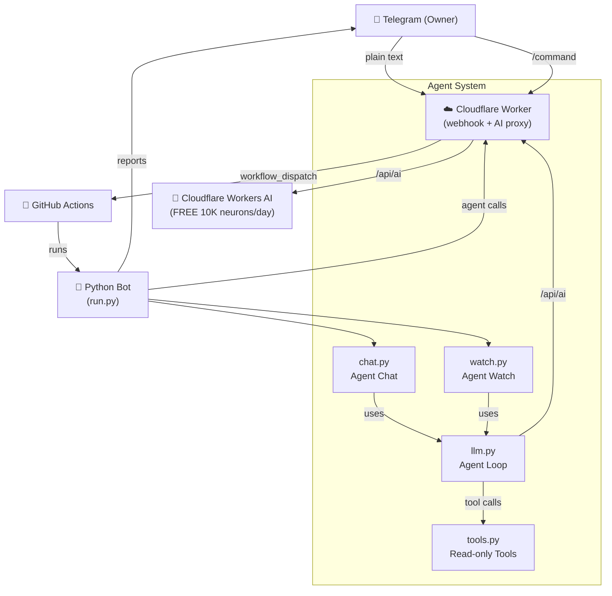
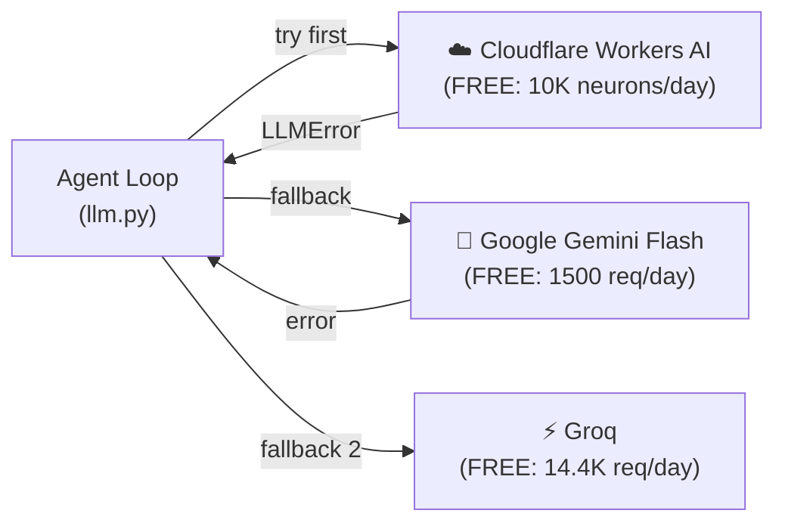

# 🔍 Bindal Exports Bot — Reverse Engineering Report & OpenCode Integration Analysis

## 1. Bot Architecture Overview



## 2. Current Agent Architecture (Reverse Engineered)

### 2.1 LLM Provider: Cloudflare Workers AI (FREE)

> [!IMPORTANT]
> The bot already uses **FREE AI** — via Cloudflare Workers AI's free daily allocation (10,000 neurons/day ≈ \$0.11 worth). No paid API key needed!

**File:** [`llm.py`](file:///g:/My%20Drive/BINDAL%20EXPORTS/BOTS/Bindal%20Exports%20Bot/bindal/agent/llm.py)

| Setting | Value |
|---------|-------|
| Default Model | `@cf/openai/gpt-oss-120b` (120B param, free) |
| Alt Models | `@cf/qwen/qwen3.8-27b`, `@cf/nvidia/nemotron-3-120b-a12b`, `@cf/openai/gpt-oss-20b` |
| API Endpoint | `DASHBOARD_URL/api/ai` (Cloudflare Worker proxy) |
| Auth | `DASHBOARD_TOKEN` (Bearer token) |
| Max Tokens | 4,000 |
| Tool Calling | OpenAI-compatible format |
| Cost | **FREE** (within 10K neurons/day allocation) |

### 2.2 Agent Loop (ReAct Pattern)

**File:** [`llm.py`](file:///g:/My%20Drive/BINDAL%20EXPORTS/BOTS/Bindal%20Exports%20Bot/bindal/agent/llm.py#L84-L107)

```python
def agent_loop(system, task, tools, max_steps=8, model=MODEL):
    # 1. System prompt + user task
    # 2. Loop up to max_steps:
    #    a. Send messages to Cloudflare Workers AI
    #    b. If no tool_calls → return answer
    #    c. If tool_calls → execute each, send results back
    #    d. If out of steps → force final answer
    # 3. Returns (answer_text, usage_dict)
```

### 2.3 Tool System

**File:** [`llm.py`](file:///g:/My%20Drive/BINDAL%20EXPORTS/BOTS/Bindal%20Exports%20Bot/bindal/agent/llm.py#L33-L47) — `@tool` decorator

The `@tool` decorator auto-generates OpenAI-format function schemas from Python type hints + docstrings.

**Read-Only Tools** ([`tools.py`](file:///g:/My%20Drive/BINDAL%20EXPORTS/BOTS/Bindal%20Exports%20Bot/bindal/agent/tools.py)):
| Tool | Purpose |
|------|---------|
| `recent_runs` | List GitHub Actions runs |
| `run_log` | Read decrypted run logs (grep/tail) |
| `run_files` | List files from a run's output |
| `sheet_summary` | Summarize an Excel sheet from a run |

**Chat Tools** ([`chat.py`](file:///g:/My%20Drive/BINDAL%20EXPORTS/BOTS/Bindal%20Exports%20Bot/bindal/agent/chat.py)):
| Tool | Purpose |
|------|---------|
| `find_order` | Look up order in OMSGuru |
| `sale_by_channel` | Units per channel for a day |
| `due_today` | Orders at risk of SLA breach |
| `propose_action` | Send Approve/Reject to owner on Telegram |

### 2.4 Two Agent Modes

#### Mode 1: Agent Watch (`watch.py`)
- **Trigger:** After every bot run on GitHub Actions
- **Purpose:** Reviews run logs, detects failures/anomalies
- **Output:** `STATUS: OK` (silent) or `STATUS: ALERT` (Telegram message)
- **Smart filtering:** Plainly-fine runs skip the AI call entirely (saves neurons)

#### Mode 2: Agent Chat (`chat.py`)
- **Trigger:** Any plain text message in Telegram (not a `/command`)
- **Purpose:** Answer owner's questions about orders, sales, etc.
- **Safety:** Can only READ; any action requires `propose_action` → Approve/Reject buttons

### 2.5 The Cloudflare Worker (AI Proxy)

**File:** [`worker.js`](file:///g:/My%20Drive/BINDAL%20EXPORTS/BOTS/Bindal%20Exports%20Bot/worker/src/worker.js#L474-L498)

The worker's `/api/ai` route is a proxy to Cloudflare Workers AI:
```javascript
// Allowed models (free tier with tool calling):
const AI_MODELS = new Set([
    "@cf/openai/gpt-oss-120b",
    "@cf/qwen/qwen3.8-27b", 
    "@cf/nvidia/nemotron-3-120b-a12b",
    "@cf/openai/gpt-oss-20b"
]);

async function runAI(request, env) {
    // Validates auth → validates model → env.AI.run(model, input) → returns response
    // Free allocation: 10,000 neurons/day
}
```

## 3. Environment Variables Summary

| Variable | Purpose | Category |
|----------|---------|----------|
| `DASHBOARD_URL` | Cloudflare Worker URL | **Agent** |
| `DASHBOARD_TOKEN` | Auth for Worker API | **Agent** |
| `AGENT_MODEL` | Override default model | **Agent** |
| `AGENT_CHAT_STEPS` | Max tool steps in chat (default 8) | **Agent** |
| `AGENT_MAX_STEPS` | Max tool steps in watch (default 6) | **Agent** |
| `TELEGRAM_BOT_TOKEN` | Telegram bot | **Core** |
| `TELEGRAM_CHAT_ID` | Default chat | **Core** |
| `GITHUB_TOKEN` / `GH_TOKEN` | GitHub API | **Core** |
| `ARTIFACT_KEY` | Decrypt run outputs | **Agent** |
| `OMSGURU_EMAIL/PASSWORD` | OMSGuru login | **Portals** |
| `GEMINI_API_KEY` | Google Gemini (AJIO SPF OCR only) | **SPF** |

## 4. OpenCode Integration Analysis

### 4.1 What is OpenCode?

OpenCode is an **open-source AI coding agent** (MIT license) — a terminal/desktop tool for writing code. It is **NOT a library/SDK** that can be imported into Python projects.

### 4.2 Why OpenCode Won't Work Here

> [!CAUTION]
> OpenCode **cannot be integrated** into this bot. Here's why:

| Reason | Detail |
|--------|--------|
| **Wrong purpose** | OpenCode is a *coding assistant* (reads/writes code files). Your bot is a *business operations agent* (reads orders, generates reports). |
| **Not a library** | OpenCode is a standalone Go/TypeScript CLI app. No Python SDK. Can't `import opencode`. |
| **No API** | OpenCode has no server mode or API to call from Python. |
| **Model-agnostic harness** | OpenCode itself is just the agent loop + file tools. The "free" part is just using free models (Ollama/Gemini API). |
| **Your bot already does this better** | Your `llm.py` already has a clean agent loop with free models via Cloudflare Workers AI. |

### 4.3 What OpenCode's "Free Models" Actually Are

When people say "OpenCode free agent", they mean:
1. **OpenCode software** = free (MIT license)
2. **Models** = you bring your own. Free options:
   - Ollama (local: Qwen, Llama) — needs GPU on the machine
   - Google AI Studio (Gemini) — free tier API
   - Groq — free tier API

**Your bot already has the equivalent:** Cloudflare Workers AI free tier, which gives you GPT-OSS 120B, Qwen 27B, Nemotron 120B — all with tool calling — for free.

## 5. What CAN Be Done Instead

> [!TIP]
> Your bot's agent system is already well-designed. Here are concrete improvements you can make:

### Option A: Add More Free Models (Direct API)

Instead of going through the Cloudflare Worker, you could call free model APIs directly from Python:

| Provider | Model | Free Tier | Tool Calling |
|----------|-------|-----------|-------------|
| Google AI Studio | Gemini 2.5 Flash | 1,500 req/day | ✅ Yes |
| Groq | Llama 3.3 70B | 14,400 req/day | ✅ Yes |
| Groq | Qwen QWQ 32B | 14,400 req/day | ✅ Yes |
| Together AI | Llama 3.3 70B | \$25 free credit | ✅ Yes |
| Cloudflare (current) | GPT-OSS 120B | 10K neurons/day | ✅ Yes |

### Option B: Add Gemini as a Fallback (Already Have the Key!)

Your `.env.example` already has `GEMINI_API_KEY`! You can add Gemini as a fallback when Cloudflare's free allocation runs out.

### Option C: Local Ollama Models (For Heavy Use)

Run models locally with Ollama — unlimited, completely free, no API key:
```bash
ollama run qwen2.5-coder:32b   # or llama3.3:70b
```

## 6. Recommended Integration Plan

> [!IMPORTANT]
> **Best approach:** Add **Google Gemini (free tier)** as a fallback provider in `llm.py`, so when Cloudflare's neurons run out, it switches to Gemini automatically.

### Architecture After Integration:



This would give you **practically unlimited free AI** for the agent.

---

**Shall I implement this? The changes would be in [`llm.py`](file:///g:/My%20Drive/BINDAL%20EXPORTS/BOTS/Bindal%20Exports%20Bot/bindal/agent/llm.py) only — adding Gemini and Groq as fallback providers.**
